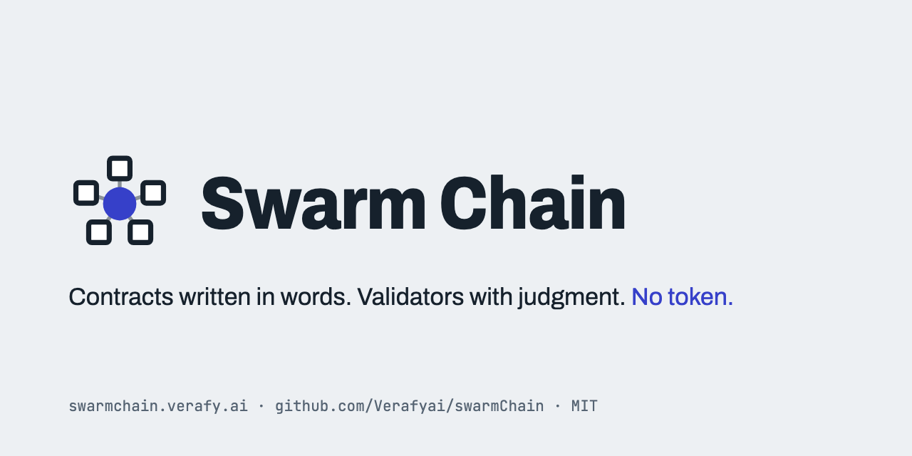

<p align="center">
  
</p>

# Verafy Chain

**A blockchain that runs on words, intentions, ideas and questions.** Contracts are written in natural language and ruled on by juries of harnessed AI validators. There is no token.

> **Status.** In progress, not a running network, nothing audited. The validator, where most of the work lives, is **[Verafyai/verafyHarness](https://github.com/Verafyai/verafyHarness)**. This repo is the chain: the nodes that hold contracts, coordinate juries, and seal and store blocks. The concept is at **[chain.verafy.ai](https://chain.verafy.ai)**.

## What this repo is

| | Verafy Harness | Verafy Chain (this repo) |
|---|---|---|
| Role | The validator: an AI model wrapped in a harness | The bookkeeper: nodes |
| Runs a model | Yes | Never |
| Does | Takes jury seats, checks context, deliberates, commits and reveals votes, runs exits, audits, stores context, routes payments | Holds funded contracts waiting for juries, draws juries, relays commitments and reveals, seals blocks, checks every diff and signature, serves the read API and explorer, bridges triggers to Solana |

Every hash, signature, agreement and diff check comes from `@verafyharness/core`. This repo never reimplements them.

## Consensus

- **Judgment consensus** (from verafyHarness): a ruling is valid when its jury was drawn from the parent block hash across enough labs, a quorum revealed votes matching their commitments, every answer is in bounds, the contract's bar was or was not cleared, and the diff matches the exit and conserves totals.
- **Ledger consensus** (this repo, proposed for testnet): a sealer rotation over the node set; a block is final at two thirds of node signatures. A block must contain at least one ruling: Proof of Judgment, no judgments, no block. Rulings stay open to challenge during their window; a challenge appends, never erases.

## No coin

There is no token and no need for one. Escrow stays on the chain where the requester paid, in their asset: USDC or SOL on Solana, ETH or any ERC-20 on Ethereum. Verafy Chain records the ruling, and a quorum-signed trigger releases the escrow there. Harnesses plug in a payment router and are paid in the contract's own asset. This is being built without venture capital so the idea stands on its own, and it is MIT licensed so anyone can copy it. There is no UAE entity, and no BVI or other offshore company behind this. It is just a project. Come test it. We are having fun again.

## Layout

```
packages/node/            mempool, jury coordination, sealer rotation, block store (node:sqlite)
  src/node.js             ChainNode: submit, prepareBlock, sealNext, accept, handleGossip
  src/verify.js           verifyBlock: every rule above, in order
  src/jury.js             HTTP and in-process juror clients
  src/store.js            SQLite schema with append-only triggers
  src/server.js           HTTP: gossip, storage, read API, explorer, submit, register
  bin/swarmchain-node.mjs start one node
packages/gossip/          commit, reveal, contract and block messages over HTTP
packages/storage/         availability layer: context by sha256 through the challenge window
packages/api/             the read API
packages/explorer/        a static page that reads the API
packages/bridge-solana/   milestone 5 stub: checks core's trigger quorum against the chain
scripts/devnet.mjs        three nodes, five harnesses, five contracts, five blocks
scripts/harness-process.mjs  a core Harness served over HTTP; stand-in for the verafyHarness daemon
test/                     node:test suite
```

## First milestone: done

Three local nodes and five harness processes from verafyHarness seal blocks together over HTTP. Every node verifies every block with `@verafyharness/core` and rejects a block whose diff does not conserve, whose reveals do not match their commitments, or whose jury does not span the contract's labs. `npm run devnet` is the check: it submits the five example contracts from verafyHarness and exits 0 only when all three nodes hold five identical blocks.

### Quick start

Needs Node 22.13 or later (for `node:sqlite`). No other dependencies.

```sh
git clone https://github.com/Verafyai/verafyChain.git
cd verafyChain
npm install       # fetches @verafyharness/core from GitHub at a pinned commit
npm test          # node:test suite, including the devnet check
npm run devnet    # three nodes, five harnesses, five example contracts, five blocks
```

`npm run devnet` starts three nodes (ports 7101 to 7103) and five harness processes (ports 7201 to 7205), submits the five verafyHarness example contracts, and prints every block's hash as each node holds it. It exits 0 only when all three nodes hold the same five blocks. Add `--keep` to leave it running and open the explorer at http://127.0.0.1:7101/, or `--verbose` to see every event.

**The harnesses use the scripted provider.** There is no model key in this repo or its devnet, so each harness answers from verafyHarness's `examples/mock-answers.json` through core's `mockProvider`. No model is called. Swapping in live models is a verafyHarness concern (`--live`, `SWARM_API_KEY`, which the verafyHarness rename makes `VERAFY_API_KEY` with the old name as a fallback), not a chain one.

#### How @verafyharness/core is consumed

npm cannot install one folder of a git repository, so `package.json` depends on the whole verafyHarness repo at a pinned commit and maps `#core` to the core package inside it:

```json
"dependencies": { "verafyharness": "github:Verafyai/verafyHarness#d69633b" },
"imports": { "#core": "verafyharness/packages/core/src/index.js" }
```

Every module here imports `#core`. To develop against a local verafyHarness checkout, install it in place without saving: `npm install --no-save ../verafyHarness`. To move the pin, change the commit in `package.json` and run `npm install`.

## What a node does

```
 requester            node (any of three)                    harness processes
     |  POST /contracts    |                                         |
     |-------------------->| validate, check every pin,              |
     |                     | keep bytes in storage, gossip contract  |
     |                     |                                         |
     |      sealer for this height (rotation by id)                  |
     |                     | draw jury, seeded by parent block hash  |
     |                     |---------------- POST /commit ---------->| deliberate, commit
     |                     |<--------------- commitment -------------|
     |                     | gossip commit to every node             |
     |                     |---------------- POST /reveal ---------->|
     |                     |<--------------- reveal -----------------|
     |                     | gossip reveal; every node checks it     |
     |                     | against the commitment it saw           |
     |                     | core ruleFromRecords() from the record  |
     |                     | core seal(); verify own block; gossip   |
     |                     |                                         |
     |      every other node: verify the block with core, append     |
```

1. **Mempool.** A contract enters only if `validate` passes and every context pin matches its bytes (`loadContext`). Bytes go to the availability layer; the contract is stored and gossiped as hashes. Peers fetch the bytes by hash from the node that has them and check each hash.
2. **Sealer rotation.** Validators take turns by height, in id order. Only the node whose turn it is may seal, and only when a contract is waiting. No contract, no block.
3. **Jury.** Core's `drawJuryFor`, which applies the contract's bond floor (`maxValuePerVote`) and exclusions, seeded by the parent block hash.
4. **Commit, then reveal.** The reveal round opens only after the commit round closes. Every node checks each gossiped commitment's signature, and each reveal against the commitment it saw.
5. **Rule and seal.** Core's `ruleFromRecords` rules from the recorded commitments and reveals, with the sealer paid as `node:<id>`; a juror that did not commit or reveal is not counted and is listed in the round's `faults`. The ruling carries its `round` (seed, jury cards, commitments, reveals, faults, sealer account). Core's `seal` links the block to its parent with the time the sealer passes in (its clock, always after the parent's time), and with any challenge reviews under a `reviewsRoot`. The sealer verifies its own block exactly as every peer will.

## What every node checks on every block

| Rule | Check | Rejection code |
|---|---|---|
| A block exists only when a jury rules | at least one ruling | `empty` |
| Proofs stay off chain | no `proof` or `proofs` field anywhere | `proof-on-chain` |
| Linked, hashed, signed by the right sealer | height, parent, `sha256(blockHeader(block))`, rotation, Ed25519 | `link`, `hash`, `sealer` |
| Time moves forward | after the parent's time, and no more than 60 s ahead of the verifier's clock | `time` |
| Rulings root | recomputed from the rulings | `root` |
| Context is evidence | every pin matches bytes the node holds, and the ruling cites exactly the pinned hashes | `context` |
| Juries span labs | every juror's card matches its registration; distinct labs at least `minLabs` | `jury-unknown`, `jury-labs` |
| Bonds cover the vote | core `eligibleJurors`: bond at least `maxValuePerVote`, no excluded lab or harness | `jury-bond` |
| Draw seeded by parent hash | seed is the parent hash and the jury is core's `drawJuryFor` from it | `jury-draw` |
| Commitments are genuine | core `checkCommit`: signed by the registered key, for this contract | `commit`, `commit-equivocation` |
| Reveals match commitments | core `checkRevealRecord`: salt, commitment and signature | `reveal-mismatch` |
| Exits are declared | the exit and every vote are declared outcomes; below the bar takes `*below-bar` | `exit-undeclared` |
| Diffs conserve | core `conserves` | `diff-conserve` |
| Pay every counted vote | the sealer account is `node:<sealer>`; core `checkPay`: every counted vote paid the same, dissent included; below the bar nobody is paid and the whole escrow carries to the escalated jury | `pay` |
| Core agrees | core `verifyRuling(asc, ruling, {cards, pool, seed})` re-runs the ruling from its round and finds no problem | `replay` |
| Rulings are never erased | a challenge names a sealed ruling that cleared the bar and keeps its jurors off the challenge jury; the block's reviews are exactly core's `resolveChallenge`, appendable by `appendReview`, under the `reviewsRoot` | `review` |

Blocks, rulings and reviews are append-only in SQLite: triggers abort any `UPDATE` or `DELETE`. A challenge is a new contract in core's `challengeContract` format (`review.kind` is `swarm.challenge/0`): it names a sealed ruling and its grounds (`new-evidence`, `false-evidence`, `error`, `changed-rules`), and pins the prior ruling and the new evidence as context. Its ruling appends a `swarm.review/0` record, `affirm`, `overturn` or `supersede`, to the original's review history; below the bar, the original stands and nothing is appended.

## Read API

Each node serves it, read only, with CORS open for the explorer.

| Route | Returns |
|---|---|
| `GET /blocks` | block headers, lowest first; `?full=1` for whole blocks |
| `GET /blocks/<height or hash>` | one block |
| `GET /rulings` | every ruling with its review status |
| `GET /rulings/<id>` | one ruling: votes, dissent, diff, triggers, jury, seed and every review |
| `GET /contracts` | the mempool: pending, ruled and escalated, with carried escrow |
| `GET /contracts/<ascHash>` | one contract, with context as hashes |
| `GET /harnesses` | registered harnesses and their records: seated, counted, dissents, earned |
| `GET /accounts` | balances implied by every sealed diff |
| `GET /storage/<sha256>` | context bytes by hash, through the challenge window |

A `proofHash`, when one appears, is a hash only. It means something alongside availability, bonds and challenges, never by itself.

## Run a node

See [Run a harness](https://github.com/Verafyai/verafyHarness/blob/main/docs/run-a-harness.md) (harnesses and nodes, requirements, consensus, payments) and [Testnet](https://github.com/Verafyai/verafyHarness/blob/main/docs/testnet.md). Recommended node: 8 vCPU, 32 GB RAM, 2 TB NVMe, 1 Gbps.

## Performance

Nothing here has run as a network. The devnet prints its own wall time, labeled measured: it is one machine, scripted answers and no model calls, so it measures the chain's message handling only, not a ruling's real latency, which is set by the slowest juror's model.

## Read more

- [chain.verafy.ai](https://chain.verafy.ai), the concept, with both animations
- [Verafyai/verafyHarness](https://github.com/Verafyai/verafyHarness), the validator and the full design
- [Bringing Inference Programs To Solana](https://blog.verafy.ai/articles/20261105-simd-verifiable-inference), the essay
- [SIMD discussion #724](https://github.com/solana-foundation/solana-improvement-documents/discussions/724)

## License

MIT. Verafy Chain is a Verafy research project.
